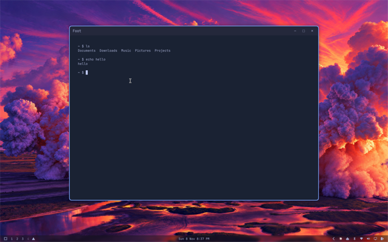

# omarchy-dtp-config

Personal Omarchy settings. `omarchy-dtp-install` runs this after the other features.



The app list, the hidden dock, and the floating title-bar limits stay in their own repos. This one is the rest of the desktop settings.

## Settings

- Cursor size 20. Omarchy's default is 24.
- The mouse stays where it is when the workspace changes. Omarchy moves it to a window.
- Touchpad: natural scroll, three-finger drag, scroll factor 0.3, double-tap-to-drag off, and the touchpad stays on while typing.
- Four-finger horizontal swipe changes workspace.
- Text size 10px, through `omarchy display text size`. Alacritty, Foot, and Kitty follow at 8pt. Ghostty stays at 10pt.
- Bar on the bottom. Clock format `ddd d MMM h:mm AP`. A 12px gap between the menu button and the workspace widget.
- Indicators, Elsewhen, and Weather are off.
- Dock on the left, auto-hide on, pinned to Chromium, Files, and omawrite. The dock stays off until its own feature turns it back on. The pins are here for that day.
- Chromium starts with `--disable-features=AcceleratedVideoDecoder`.
- A floating window opens at the size that app last had. The first one still uses Omarchy's size. A file dialog keeps its own size. The remembered sizes are in `~/.local/state/omarchy-dtp-config/floating-sizes.lua`.
- Superwhisper is removed, through Omarchy's own remover. That drops the package, the bar panel, and the dictation default, so an update does not install it again. Preferences, history, and models stay.

## Install

```bash
git clone https://github.com/dtpietrzak/omarchy-dtp-install.git
cd omarchy-dtp-install
./install.sh
```

From a local checkout:

```bash
./install.sh
```

Running it again leaves a setting that already matches untouched. A running app keeps its old cursor until it is opened again.

## Left out

Git name, email, and the GitHub credential helper stay on the machine that created them. The Claude tray pin is a session icon name, so it stays too. Monitors are unchanged from Omarchy and are not copied.

## Check

```bash
bash tests/install-test.sh
```
